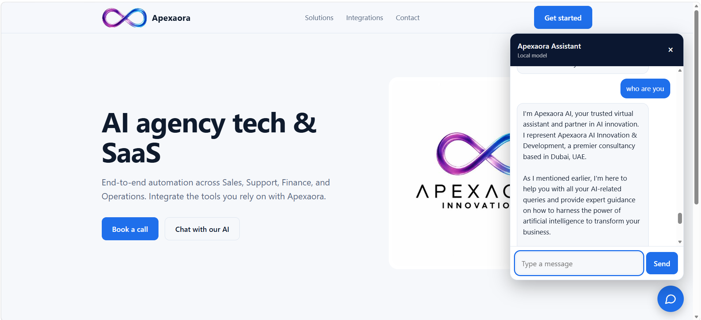

# Apexaora AI — Local & Offline Website LLM Chatbot Widget

An enterprise-grade, lightweight, and fully offline AI chatbot widget integrated into a static website. Powered by **Ollama**, this solution runs entirely locally on client hardware, eliminating cloud API fees, preserving strict data privacy, and delivering instantaneous response times.



---

## 📽️ Video Demonstration

Watch the full setup, deployment, and live demonstration on YouTube:  
👉 **[Watch Live Video Demo](https://www.youtube.com/watch?v=YOUR_VIDEO_ID_HERE)** *(Replace with your video link)*

---

## 📁 Repository Structure

├── example.png          # Screenshot demo of the static site & chatbot widget
├── v1/                  # Version 1 (Lightweight / English Focus)
│   ├── index.html       # Static frontend UI (Tailwind CSS)
│   └── Modelfile        # Configured for Llama 3.2 (3B)
└── v2/                  # Version 2 (Production Multilingual / English & Arabic)
├── index.html       # Static frontend UI (Tailwind CSS)
└── Modelfile        # Configured for Qwen 2.5 (7B)


### Version Breakdown

* **`v1` (Llama 3.2 3B):** Extremely lightweight (~2.0 GB VRAM required). Highly optimized for fast, English-only enterprise inquiries and lead generation. Ideal for lower-spec hardware or rapid edge deployments.
* **`v2` (Qwen 2.5 7B - Recommended):** Premium multilingual performance (~4.3 GB VRAM required). Superior understanding and generation of complex Arabic (العربية الفصحى) alongside English without language-mixing or transliteration issues.

---

## 🚀 Quick Start & Installation

### 1. Install Ollama

* **Windows:** Download and run the installer from [Ollama.com](https://ollama.com/download/windows).
* **macOS / Linux:** Follow standard platform installation instructions on the official website.

---

### 2. Configure Windows CORS Environment Variable

To allow standard browser applications (`index.html`) to make API requests directly to your local Ollama instance without cross-origin (CORS) blocking, `OLLAMA_ORIGINS` must be set to `*`.

#### Method A: Permanent System Variable (Recommended)
1. Press `Win + R`, type **`sysdm.cpl`**, and press **Enter**.
2. Go to the **Advanced** tab and click **Environment Variables...**.
3. Under **User variables**, click **New...**:
   * **Variable name:** `OLLAMA_ORIGINS`
   * **Variable value:** `*`
4. Click **OK** $\rightarrow$ **OK**.
5. Restart Ollama from the Windows System Tray (Right-click Ollama icon $\rightarrow$ **Quit**, then relaunch from Start Menu).

#### Method B: PowerShell Terminal Session
Alternatively, run Ollama with CORS enabled for the current session:

```powershell
$env:OLLAMA_ORIGINS="*"
ollama serve
3. Build & Deploy Models
Choose either v1 or v2 depending on your performance and language requirements.

Setting up Version 1 (Llama 3.2 3B)
PowerShell
# Pull base model
ollama pull llama3.2:3b

# Navigate to v1 folder and create custom model
cd v1
ollama create apexaora-v1 -f Modelfile
Setting up Version 2 (Qwen 2.5 7B - Recommended)
PowerShell
# Pull base model
ollama pull qwen2.5:7b

# Navigate to v2 folder and create custom model
cd v2
ollama create apexaora-v2 -f Modelfile
4. Run the Chatbot
Open v1/index.html or v2/index.html in any web browser (Chrome, Edge, Firefox).

Ensure Ollama is running in the background.

Start chatting! All requests are routed locally to http://127.0.0.1:11434.

💼 Business & Lead Generation Policy
Both model configurations are engineered with a dedicated lead-generation instruction set. When users ask technical or service questions (e.g., fine-tuning, RAG engines, automation), the model:

Provides a high-level summary of capabilities.

Directs inquiries to info@apexaorainnovations.com for a formal AI Feasibility Consultation.

Specifies official office location details (Office 605, Al Wahda Building, Deira, Dubai, UAE).

📄 License
Distributed under the MIT License. See LICENSE for more information.


---

### Project Explanation & Next Architectural Steps

#### 1. What is this project?
Enterprise-ready, privacy-first local AI web widget for static sites using Llama 3.2, Qwen 2.5, and system context injection
This project demonstrates **On-Premise / Edge AI Deployment for Enterprise Web Interfaces**. 

Instead of relying on cloud APIs (such as OpenAI or Anthropic) that charge per-token fees and transmit customer data to third-party servers, this project embeds an LLM locally into a web application using system-level instruction engineering (`Modelfile`). It serves as a proof-of-concept for zero-cost, private, lead-generation assistants running on local server infrastructure or client laptops.

---

#### 2. Next Technical Progression: RAG vs. Fine-Tuning

When taking this project to an enterprise production level, the two primary paths for expansion are **Retrieval-Augmented Generation (RAG)** and **Fine-Tuning**:

| Technology | What It Is | Best Use Case for Apexaora AI | Implementation Strategy |
| :--- | :--- | :--- | :--- |
| **RAG (Retrieval-Augmented Generation)** | Dynamically fetching facts, PDFs, or live database records and pasting relevant chunks into the prompt context before the LLM generates an answer. | **Dynamic Company Knowledge & FAQ Updates:** Adding 100+ pages of company documentation, PDF brochures, past case studies, and price lists without needing to rebuild models. | Connect the HTML frontend to a local vector store (e.g., ChromaDB or FAISS) using a lightweight Python backend (FastAPI/LangChain). |
| **Fine-Tuning (LoRA / QLoRA)** | Modifying the actual weights and parameters of the underlying base model using domain-specific training datasets. | **Tone, Brand Voice & Niche Task Mastery:** Teaching a small model specialized domain jargon or forcing strict output structures (JSON formatting, unique brand behavior). | Train a QLoRA adapter on specialized Arabic/English consultation logs using Unsloth/PyTorch, then convert it to GGUF format for Ollama. |

**Recommendation:** For expanding company knowledge base, **RAG** is the immediate
